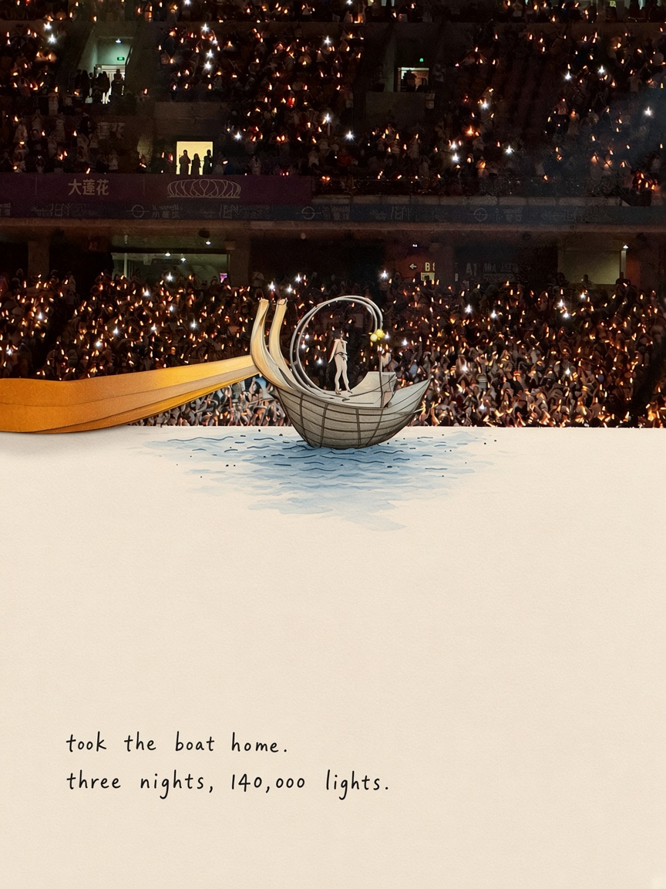
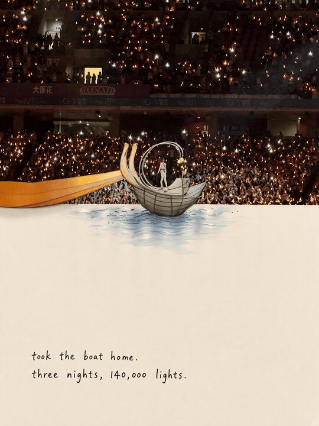
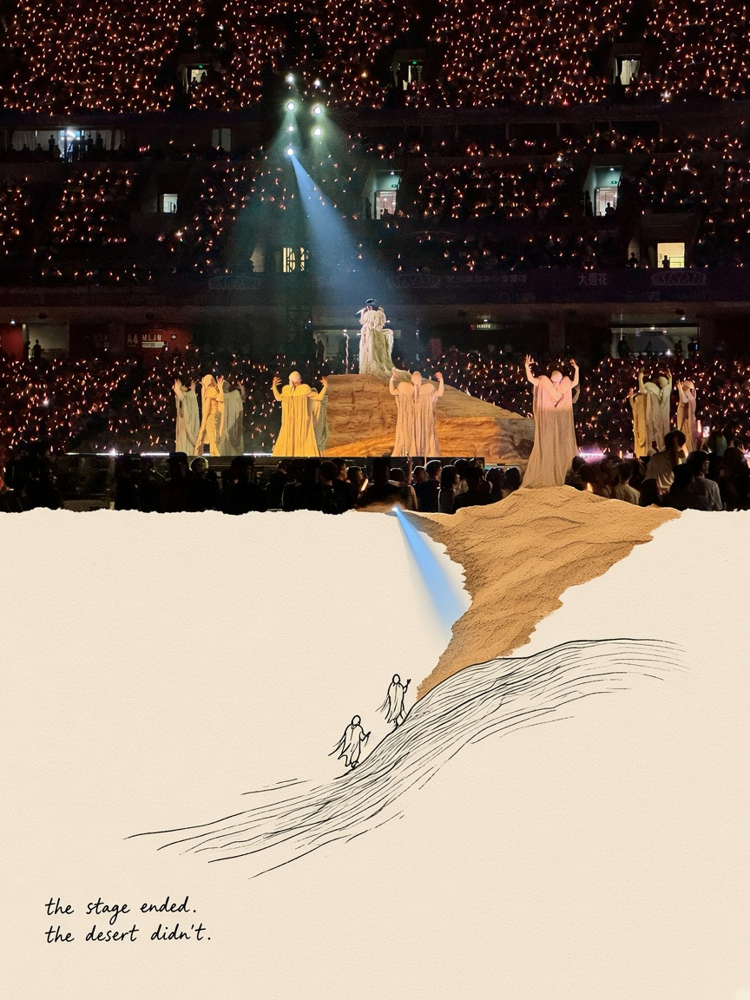
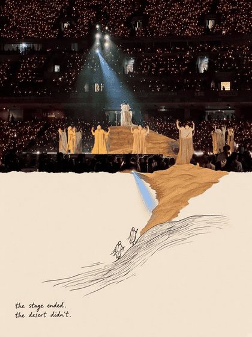

# second-world-collage

Half photo. Half paper. A quiet second world that grows out of the cut.

Upload a still. The upper half stays the same photograph. The lower half is warm cream paper, with a small supporting world blooming from whatever structure the cut follows — a boat gets a patch of sea, a stage mound becomes a paper dune. Optionally animate the **paper side** into a looping GIF; the photo subject stays still.

Signed [@uselesssoso](https://github.com/uselesssoso). No API keys. No PowerTokens.

## Examples

### Boat — *took the boat home. three nights, 140,000 lights.*

The cut follows the stage boat. A small blue sea spreads onto the paper under the hull. In the GIF, only the sea moves.

| Still | GIF |
| --- | --- |
|  |  |

### Dune — *the stage ended. the desert didn't.*

The cut follows the golden mound. Sand spills onto the paper; two tiny figures climb. In the GIF, sand drifts and the figures walk — the stage stays put.

| Still | GIF |
| --- | --- |
|  |  |

## How it works

1. **Observe** — pick one structure in the photo that can become touchable.
2. **Invent** — one second-world beat that only works for this photo.
3. **Collage** — 3:4, split in half; warm paper below; supporting mini-world blooms from the cut (not a redrawn copy of the subject).
4. **Caption** — one short English line. Light humor. No invented facts.
5. **Optional GIF** — upper photo locked (or micro-shimmer only); the paper / splice side moves in a way that fits the scene. If video generation leaves the lower half still, fall back to programmatic motion on that region only.

Full recipe: [SKILL.md](SKILL.md).

## License

MIT. The example photos belong to whoever shot them; they are used here as collage demos only.
